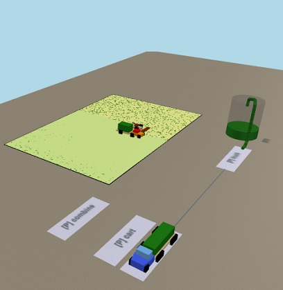

# Optimización de la Ventana de Siembra

Modelo de simulación en **AnyLogic 8.9.10 Personal Learning Edition** para el trabajo práctico de Simulación (UTN Rosario). Dimensiona la maquinaria y la logística agrícola necesarias para cerrar la siembra dentro de la ventana agronómica óptima (antes del 15/11), con clima histórico real.



Es un modelo híbrido: eventos discretos (ciclo de siembra, recarga y descarga) más un balance hídrico continuo que frena las máquinas cuando el suelo no da piso. Hay una sola máquina con dos modos (siembra y cosecha), un carro, un camión y un silo. El cultivo madura por grados-día y la campaña sigue el calendario del 1/10 al 30/9.

## Qué hay en el repo

| Ruta | Contenido |
|---|---|
| `Optimización de la Ventana de Siembra.alp` | El modelo. Es un XML autocontenido con el código Java embebido |
| `herramientas/analizar_barrido.py` | Analiza `resultados.csv`: margen de cada sistema, diferencia par a par con IC del 95%, siembra a tiempo y validaciones. Solo usa la biblioteca estándar |
| `herramientas/clima_nasa.py` | Baja el clima de NASA POWER a `datos/` y reescribe las series del modelo |
| `datos/` | Serie climática de Rosario (NASA POWER, 2005–2025) |
| `resultados.csv`, `salida/` | Resultados del barrido de 400 corridas y la tabla para graficar |
| `docs/PLAN.md` | Plan de trabajo vigente: decisiones, criterios y estado de cada paso |
| `docs/CAMBIOS-2026-10.md` | Cómo funciona el modelo de siembra, cosecha y clima anual |
| `docs/CONTEXTO-TRASPASO.md` | Estado del proyecto, calibración y aprendizajes de AnyLogic |
| `docs/ventana-siembra.html` | Explicación integral del modelo |
| `backups/` | Copias fechadas del `.alp` antes de los últimos cambios por script |

## Cómo correrlo

1. Abrir el `.alp` en AnyLogic 8.9.10 PLE.
2. Elegir un experimento:
   - `Simulation`: una corrida única, que termina al cerrar la cosecha.
   - `ParametersVariation`: el barrido de Monte Carlo (400 corridas) del sistema base contra el alternativo. Escribe `resultados.csv`.
   - `CompareRuns`: compara corridas en pantalla. La dirección web donde corre se imprime en la consola al lanzarlo.
3. Para analizar el barrido:

```bash
py herramientas/analizar_barrido.py
```

El barrido completo tiene que correrse con una sola versión de AnyLogic.

## Resultado del barrido (30/10/2026)

Base (12 lotes, 1 tren) contra alternativo (18 lotes con 6 arrendados, 2 trenes), con 20 climas × 5 réplicas:

- Siembra terminada antes del 15/11: **45%** el base, **95%** el alternativo.
- Margen por campaña: 940.130 US$ el base y 1.049.294 US$ el alternativo. La diferencia es de 109.164 US$ (IC 95% por clima [100.121 ; 118.207]). Por hectárea gana el base.
- La ventaja del alternativo se anula con un costo fijo por tren de unos 229.000 US$, un precio de la soja de unos 250 US$/t o un arriendo de unos 20 qq/ha.

Varios costos son supuestos sin fuente; están listados en `herramientas/analizar_barrido.py` y en `docs/PLAN.md`. El exceso de fallas respecto de lo esperado (+8%) está marcado y sin explicar.

## Notas

- La Fluid Library se eliminó: la edición PLE limita a 5 horas el tiempo simulado de toda librería salvo Process Modeling. Los recipientes se integran por evento.
- El código embebido en el modelo está en español sin tildes (con ñ). Los documentos llevan tildes.
- Para editar el `.alp` con scripts, seguir el procedimiento de `CLAUDE.md` (respaldo fechado, reemplazos que abortan si el patrón no aparece exactamente una vez y validación del XML).
